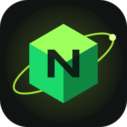
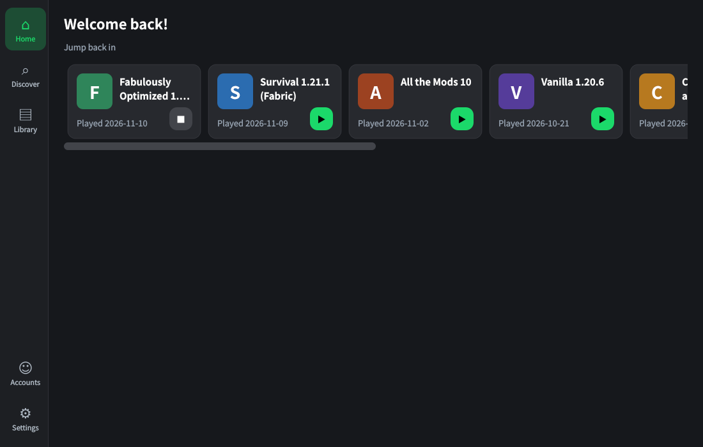
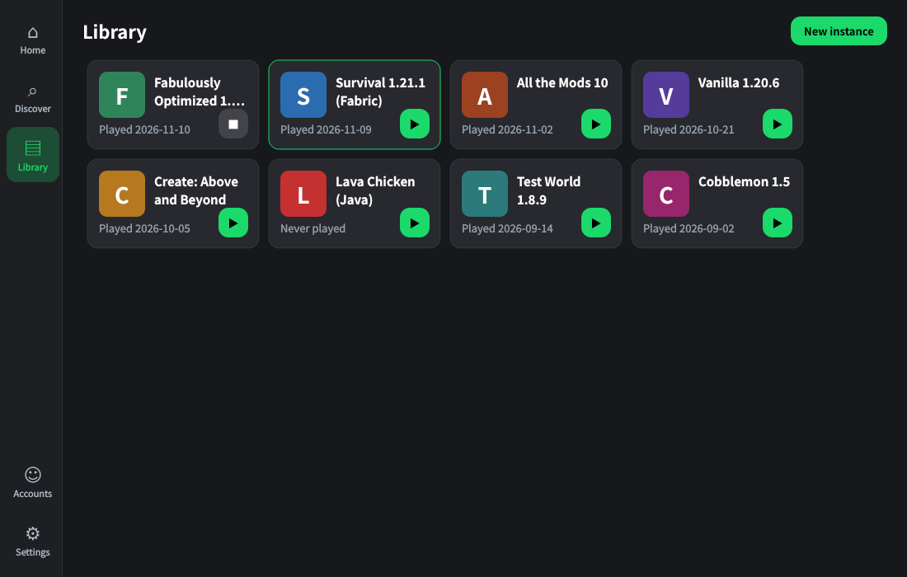
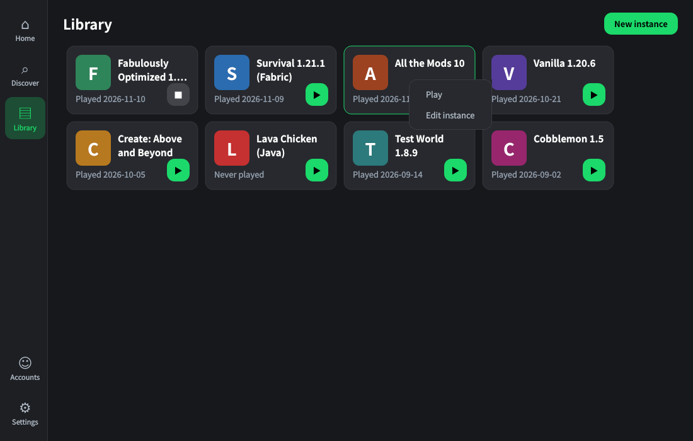
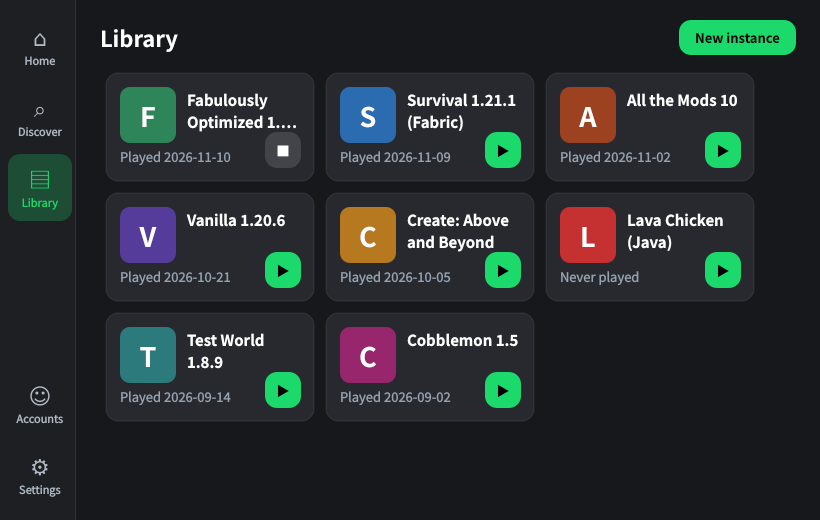

# Nitruran

A Minecraft launcher with a modern, Modrinth-App-inspired interface, running on the
[Prism Launcher](https://github.com/PrismLauncher/PrismLauncher) core.

> Early preview — Windows first.

* Interface: left sidebar, instance cards, Home / Library (more pages in progress).
* Core: Prism Launcher's instance, Java, mod-loader, account and launch logic.
* **Blocked CurseForge mods**: when an author disables third-party downloads, Nitruran looks for the byte-identical
  file (same SHA-1) on Modrinth and downloads that copy — in modpack installs (Prism already did this), in the mod
  browser and in update checks (new). It never works around the author's restriction on CurseForge itself.
* **First-run sync**: offers to import instances, accounts, icons and a few settings from Prism Launcher and
  mlcmLauncher (copies only; nothing is overwritten). Also available from the sidebar.
* Interface text in English, 繁體中文 and 简体中文 (Nitruran's own strings; Prism's translations still load as before).
* Open source under GPL-3.0.

## Screenshots

> Design previews rendered with the real Nitruran style and card-painting code, using **sample instances**.
> Real in-app captures will replace them once the first CI build is running.

| Home | Library |
|---|---|
|  |  |
| **Instance menu** | **Compact window** |
|  |  |

See [CHANGELOG.md](CHANGELOG.md) for release notes and build-from-source steps.

## Build
GitHub Actions builds Windows (MSVC, Qt 6.11.2) — see `.github/workflows/windows.yml` and the build-from-source steps
in [CHANGELOG.md](CHANGELOG.md). Nitruran's Microsoft client ID and an AES-encrypted default CurseForge key are built
in; the repository secrets `MSA_CLIENT_ID` and `CURSEFORGE_API_KEY` are optional overrides. If the built-in
CurseForge key ever stops working, enter your own under Settings → API.

## Credits and licence
Nitruran is a fork of Prism Launcher (GPL-3.0, see `COPYING.md` and `LICENSE`), whose copyright
notices are kept. The interface layout and colours follow Modrinth's open-source app design tokens;
Modrinth's name and logo are **not** used. Nitruran is not affiliated with or endorsed by Mojang,
Microsoft, Prism Launcher, Modrinth or CurseForge.
